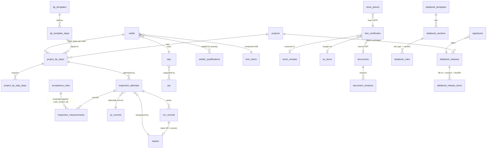
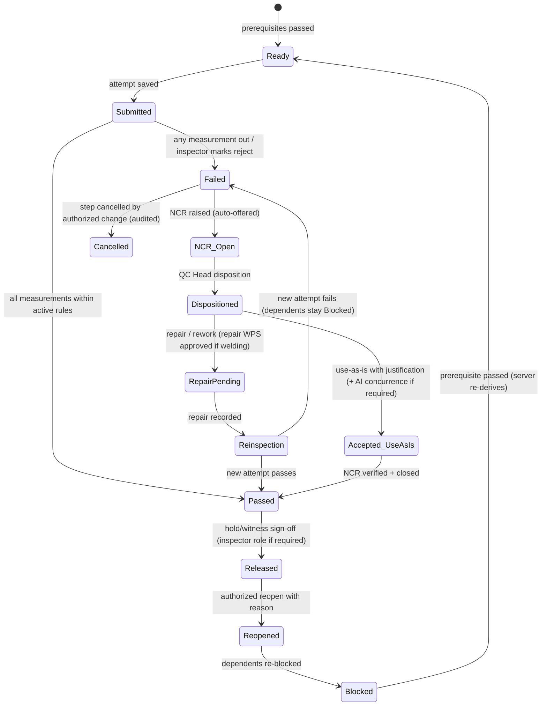

# Brief for a new chat: write the implementation plan for the ASME QA/QC work (Gulf Coast Exchanger)

You are picking this up cold. Read these first, in order:
1. The appendix at the end of this file (also saved as `docs/gulf-coast-asme-qaqc-audit.md`) — the finished audit (what exists, gaps, matrix, roadmap, risks, customer questions). Treat it as your starting point, but **re-check any claim before you build on it**.
2. `SYSTEM.md` — project-wide system doc. Search it; don't read it all. Most relevant: §5ao/§5ap (NCR + hold points), §5cf (inward + pre-dispatch approval gates), §5d/§5k/§5at/§5bj (test certificates, heat traceability), §5ay (BOM release snapshots), §5fc/§5fd (deploy targets, API router), §5ej (one deployment per customer).
3. `DEMO.md`, section "North American demo".

## Where the code is
- North American (ASME) version = git branch **`demo-us`**, worktree `~/Developer/shanti-ops-us`. It is 26 commits ahead of `main` and not merged.
- India version = `main` (`~/Developer/shanti-ops`).
- Same codebase. Region is a build-time switch: `MARKET=NA` / `NEXT_PUBLIC_MARKET=NA` (`lib/market.js`). Unset = India.
- ASME files on `demo-us`: `lib/qc-asme.mjs` (data shape + QW-322 continuity), `lib/qc-asme-pdf.js` (P-2 / U-1A package PDF), `lib/qc-ibr.mjs` (`asme` version), `lib/qc-document-fields.js` (US labels), `scripts/demo/seed-acme-us.mjs` (fills `qc_documents.asme_data`).

## Key facts from the audit (verify them)
- `qc_documents.asme_data` is one JSON column filled **only by the seed**. No API, no UI, no validation.
- The hold-point gate lives on the old `job_cards` table (`server/api/job-cards/[id]/route.js`, `.../qc-release`). The screens for it (`JobCardBoard`, `QcHoldPanel`, `WorkOrdersPanel`) are not rendered anywhere. The current shop-floor job card (`job_sheets`) doesn't block anything: `server/api/job-sheets/[id]/stages/[stageId]/route.js` line 4 says QC sign-off is "a record only".
- Real server-side gates to copy: inward review (`lib/bom-receiving.js`, `server/api/inward-approvals/`) and pre-dispatch review (`server/api/packing/[id]/route.js` ~line 82).
- `qc_records` holds only pass/fail. There are no measured values and no rule engine.
- MTRs: `test_certificates`, single-PDF AI extraction (`server/api/test-certificates/extract`, `lib/extract.js`). No batch upload, no file hash, no revisions.
- Tests: there's no test framework. Each module has a plain self-check script (`node lib/x-selfcheck.mjs`), and `npm run check` runs them all; CI runs it too. There are also API check scripts against a scratch SQLite database (`scripts/check-actions.mjs`).

## Your task: write the implementation plan (no code yet)
Write the plan to `docs/gulf-coast-asme-plan.md`. The scope is Phase 0 + the minimum demo: Phases 0, 1, 1b and 1c from the audit's §12.

Before you write it:
- Check the audit's claims against the code. Build an error list ("audit said X, code shows Y").
- **Phase 0 (merge `demo-us` market layer into `main`):** run `git diff main...demo-us --stat`, list which commits are US-only and which were already cherry-picked to `main` (the Ember AI ones were), and judge the conflict risk. India must stay byte-identical; `scripts/demo/india-snapshot.mjs` is the existing check for that.
- **For every proposed table:** first check `lib/db.js` for an existing table that fits (stage_templates, work_order_route_templates, ncr_records, inward_approvals, bom_release_snapshots, calibration_items…). Reuse before adding.
- Decide what happens to the orphaned `job_cards` hold-point code: migrate it, retire it, or reuse it. Don't leave two hold-point systems.

For each phase, the plan must give:
- the exact files to change or add;
- the migration statements (additive only, via `migrate()` / `addColumn()`);
- the routes, with permission keys in `lib/action-permissions.js`;
- the screens;
- the self-check and API checks to add;
- acceptance criteria;
- effort as a range;
- the customer inputs needed.

Include the failure → NCR → repair → reinspection → release flow as the core of Phase 1. Gates must be enforced in the write routes (a crafted API call must get a 409), not only in the UI.

## Rules
- Plan only. Don't modify code, run migrations against `.env.local` (it is the client's live database), deploy, or commit unless the owner says so.
- **Use a scratch SQLite file for any experiment:** `TURSO_URL=file:/tmp/x.db`, with `TURSO_AUTH_TOKEN` blank.
- Don't invent ASME/NBIC clauses or acceptance values. Mark them "Requires Licensed Standard Review" or put them on the list of questions for the customer. "200 ZBHN" and "ferrite 3–9" are unconfirmed customer criteria, not code rules.
- Keep India (IBR) behaviour unchanged. The new quality module is region-neutral; only the report renderers are regional.
- No new services, databases or frameworks unless the code proves they are needed.
- Write in plain, short English. Repo conventions are in `CLAUDE.md` / `SYSTEM.md`.

When the plan is done, add a short dated entry to `SYSTEM.md` pointing at it, and list any open questions for the owner at the end of the plan.

---

# Appendix: the full audit (same as docs/gulf-coast-asme-qaqc-audit.md)

# SB Ops North America — ASME QA/QC capability audit for Gulf Coast Exchanger, LLC

Date: 2026-11-11. Status: investigation only. No production code, schema or data was changed.
Evidence: the `demo-us` branch (worktree `~/Developer/shanti-ops-us`, head `b0edb4a`) and `main` (`4cd54af`).
Every "Evidence" path below is relative to the repo root and was read, not assumed.

---

## 1. Executive Assessment

**Short answer.** The North American version can carry these requirements, but most of what Gulf Coast asked for is **not built yet**. What exists is a solid operations platform (projects, BOM, procurement, stores, production, QC, dispatch) with a few *real* server-enforced quality gates and a *printed* ASME record package. The ASME welding/NDE data behind that package is a JSON blob filled only by a demo seed script — there is no screen, API or validation for it.

What is real today and reusable:
- Hard, server-side gates with resubmission history: **inward material review** (received stock is held from use until QC approves) and **pre-dispatch review** (a packing list cannot be marked dispatched until QC and Production both approve).
- **NCR workflow** with Head-only disposition, a QC-verification step before close, and rework lineage.
- **Mill Test Report bank** (`test_certificates`) with heat number, single-PDF AI field extraction with mandatory human review, and heat-to-piece-to-project traceability that survives cutting.
- **Assembled QC folder PDF** (ASME package + appended MTR PDFs) generated from live records.
- One codebase for India and North America, switched by `MARKET=NA` at build time.

What is missing for Gulf Coast:
- No configurable ITP, no inspection sequence enforcement on the shop floor job card ("a record only — nothing is blocked by it").
- No measured-value capture or rule validation (hardness, ferrite, anything).
- No weld, weld map, WPS/PQR or NDE records as data (only JSON on one row, seed-filled).
- No batch MTR ingestion, no duplicate-file detection, no document revisions or hashes.
- No configurable Data Book, no frozen released package.
- No U-1, U-5 or R-1. Only P-2 and U-1A, in "our own layout, not a facsimile of the printed ASME form".

**Realistic position.** Gulf Coast's three core concerns (MTR→BOM traceability, NDE failure blocking downstream work, live Data Book) can be demonstrated on the existing architecture without a rewrite, in an estimated **3–6 engineer-weeks** for a credible end-to-end demo (assumptions in §12). Production-grade ASME/NBIC report output depends on licensed forms, the customer's QC manual, and Authorized Inspector review — software can prepare these records but cannot certify anything.

---

## 2. Existing SB Ops North American Architecture

| Aspect | Finding | Evidence |
|---|---|---|
| Where NA lives | Branch `demo-us`, 26 commits ahead of `main`, not merged. Worktree `~/Developer/shanti-ops-us`. | `git log main..demo-us` |
| Where India lives | `main` (live client app is paused since 10 Nov 2026; India demo deploys from `main`). | `.github/workflows/deploy.yml`, commit `4cd54af` |
| Shared code? | Yes, one codebase. Region = build-time switch `MARKET` / `NEXT_PUBLIC_MARKET` (`NA` or unset = India). | `lib/market.js` (`MARKET`, `IS_US`, `INDIA_ONLY`, `usWords`) |
| How the switch works | Constants (currency, locale, time zone, FY start, paper, units, `CODE_LABEL`), hidden India-only modules, a display-time word map (inquiry/estimate/shipping/mill test report), field relabelling. | `lib/market.js`, `components/UsWords.jsx`, `lib/qc-document-fields.js` (US block), `lib/qc-ibr.mjs` (`IS_US ? ['asme']`) |
| Frontend | Next.js 15.5 App Router, React 19, Tailwind v4, shadcn/radix. Desktop + phone layouts. | `package.json`, `components/ui/` |
| Backend | Next route handlers, all API under one catch-all entry that lazy-loads `server/api/**/route.js`. | `app/api/[...path]/route.js`, `lib/api-match.mjs`, `scripts/gen-api-routes.mjs` |
| Database | libSQL/Turso (SQLite dialect); local SQLite for dev. Schema = idempotent DDL in one `migrate()`; additive `addColumn()`. | `lib/db.js`, `lib/db-client.js`, `lib/migrate-fingerprint.generated.js` |
| Files | Cloudflare R2 (S3 API); demo uses an R2 binding. | `lib/r2.js` |
| Auth | bcrypt + JWT cookie; fresh DB user check per request; roles admin/manager/executive/operator/customer/agent; department grants + Head/Member; admin-configurable Head-only actions. | `lib/auth.js`, `lib/action-permissions.js` |
| Audit | `usb_audit` append-only by convention (no update/delete route found), actor + action + JSON detail. Global viewer in Accounts. | `lib/db.js` (`CREATE TABLE usb_audit`), `server/api/audit-log` |
| PDF | `@react-pdf/renderer` + `pdf-lib` merge. | `lib/qc-asme-pdf.js`, `lib/qc-folder-pdf.js` |
| AI | OpenRouter for MTR field extraction and the Ember assistant. | `lib/extract.js`, `lib/assistant*.js` |
| Background work | No job queue. Best-effort post-request work (`waitUntil` on Workers), daily cron Workers. | `workers/`, `lib/quickbooks-sync.js` |
| Deployment (NA) | Cloudflare Workers via OpenNext, `wrangler.us.jsonc`, `npm run deploy:demo:us`. Same code also runs on plain Node (Render). One deployment + database per customer. | `wrangler.us.jsonc`, `package.json` scripts, SYSTEM.md §5ej/§5fc |
| Tests | No test framework. ~108 dependency-free self-check scripts, run by `npm run check` and CI; Python E2E scripts; assistant action checks. | `scripts/check-all.mjs`, `scripts/test_e2e/`, `scripts/check-actions.mjs` |

**Important:** NA has no production customer deployment. It runs only as the public demo `boiler-erp-us.ahromlabs.com` with seeded "Acme Boilers Inc." data.

---

## 3. Verified Capability Inventory

Status key: **Complete** = implemented and exercised by a check or live use; **Partial**; **Demo-only** = data comes only from a seed; **UI-orphaned** = server code exists but no rendered screen reaches it; **Absent**.

| Capability | Status | Evidence |
|---|---|---|
| Market switch (NA vs India) | Complete (self-check `market ok (IN + NA)` run during this audit) | `lib/market.js`, `lib/market-selfcheck.mjs` |
| ASME record package PDF: index, P-2 / U-1A, weld map sketch, WPS/PQR, welder continuity, MTRs, NDE, PWHT, hydro | Partial — printed output only | `lib/qc-asme-pdf.js` (`renderAsmeFolderPdf`), header comment: "our own layout … not a facsimile" |
| ASME welding/NDE data (`asme_data`) | **Demo-only** — one JSON column, written only by the seed; no API, no UI, no validation | `lib/db.js:5404`, `scripts/demo/seed-acme-us.mjs:559`, `lib/qc-asme.mjs` (shape) |
| QW-322 welder continuity check | Logic complete + self-check (`qc-asme ok`); `weldMapProblems()` is called by nothing except the self-check | `lib/qc-asme.mjs`, `lib/qc-asme-selfcheck.mjs` |
| QC test records (`qc_records`) | Complete but shallow: free-text `test_type`, `result` pending/pass/fail, no measured values | `lib/db.js:311`, `server/api/qc-records/route.js` |
| NCR: raise / disposition (Head) / verify / close, rework card | Complete for the old `job_cards`; rework creation targets the retired table | `lib/db.js:5149`, `server/api/ncrs/[id]/{disposition,verify,close}` |
| Hold point (job cannot finish until QC release; release refused while an NCR is open) | **UI-orphaned** — enforced on `job_cards`, but `JobCardBoard`, `QcHoldPanel`, `WorkOrdersPanel` are not rendered anywhere | `server/api/job-cards/[id]/route.js:48`, `server/api/job-cards/[id]/qc-release`, grep of `components/` |
| Current shop-floor job card (33/16-stage `job_sheets`) | Complete as a record; QC sign is "a record only — nothing is blocked by it" | `server/api/job-sheets/[id]/stages/[stageId]/route.js:4` |
| Milestone dependency engine | Partial — read-only "blocked by" signal, never enforced | `lib/dependency.mjs` (`milestoneReadiness`) |
| Inward material review gate | Complete, server-enforced, resubmission history kept | `lib/bom-receiving.js:66`, `server/api/inward-approvals/` |
| Pre-dispatch QC + Production gate | Complete, server-enforced | `server/api/packing/[id]/route.js:82` |
| MTR bank, AI extraction from one PDF, human review before save | Complete for single upload | `server/api/test-certificates/extract/route.js`, `lib/extract.js` |
| Heat traceability: receipt → cut pieces → project → statutory parts | Complete (heat/cert inherited on cut; cert↔project join; per-unit cert cells) | `lib/stock-pieces.js`, `certificate_projects`, `bom_item_child_certificates`, `lib/qc-bom-sync.js` |
| Batch MTR ingestion, duplicate-file detection, file hash, cert revisions | Absent | no hash use outside OAuth/leads/e-way code |
| Calibration register | Complete (due/expired derived) | `calibration_items`, `server/api/calibration-items` |
| ASME design calc (PG-27, UG-27) with unit handling and versioned formulas | Complete (Calc module) | `lib/calc-engine.js`, `lib/db.js:6858` |
| Configurable checklist templates (stage templates, route templates) | Complete for milestones / work orders | `stage_templates`, `work-order-route-templates` |
| Frozen release snapshot pattern | Complete for BOM releases | `bom_release_snapshots` |
| Data Book (configurable sections, completeness, released version) | Absent (fixed folder, regenerated on every request) | `lib/qc-folder-pdf.js:2246` |
| U-1, U-5, R-1 forms | Absent | — |
| Authorized Inspector role, electronic signature | Absent (sign = username + timestamp) | `lib/auth.js` role list |

---

## 4. Detailed Gulf Coast Requirements Matrix

Complexity L/M/H. Risk T = technical, O = operational, C = compliance.

| ID | Requirement | Existing | Evidence | Status | Compliance dependency | Gap | Reuse | Approach | Cx | Risk | Acceptance criteria |
|---|---|---|---|---|---|---|---|---|---|---|---|
| A1 | Configurable ITP template (ordered steps, step type: hold/witness/review/surveillance) | Stage templates, route templates (no inspection semantics) | `stage_templates`, `work_order_route_templates` | Absent | Customer QC manual; ASME requires inspection by AI at stages the AI defines | Entity, editor | Template + copy-at-project-creation pattern (`createProjectMilestones`) | `itp_templates` + `itp_template_steps`, copied into `project_itp_steps` | M | O | Template edited after use does not change applied project ITP; step order and types preserved |
| A2 | Prerequisites / dependency graph between steps | Milestone predecessor, advisory | `lib/dependency.mjs` | Partial | Customer ITP | Many-to-many deps, enforcement | Cycle guard in `server/api/dependency-chain` | `project_itp_step_deps` (step → required step); cycle check on save | M | T | Cycle rejected; a step's "ready" computed from all prerequisites |
| A3 | Hard gate: dependent work blocked after a failure | Hard gates exist for inward, dispatch, old job cards | `packing/[id]/route.js:82`, `job-cards/[id]/route.js:48` | Partial (pattern only) | Customer ITP | Gate on job-sheet stage start/finish, hydro, bundle insertion, shipment | Same guard style: re-derive state server-side in the write route | One `itpGate(projectId, stepKey)` called inside the job-sheet stage route, QC record route, packing dispatch | M | T/C | API call to start a blocked stage returns 409 even with a crafted request |
| A4 | Inspection attempts history | `qc_records` rows, no attempt link | `qc_records` | Partial | Record retention | Attempt number, link to step, supersedes | Append-only + `resubmission_of_id` precedent (`inward_approvals`) | `inspection_attempts` with `attempt_no`, `supersedes_id`; never update a decided row | L | C | Every failed attempt remains visible after the pass |
| A5 | NCR on failure, repair, reinspection, release | NCR complete; rework tied to old job cards | `server/api/ncrs/[id]/*` | Partial | Customer NCR procedure; NBIC if a repair after stamping | Link NCR to ITP step / weld; repair record; reinspection required before release | NCR routes, Head-gated disposition, verify-before-close | Add `itp_step_id`, `weld_id` to `ncr_records`; release requires closed NCR + passing attempt | M | C | Gate stays closed until NCR closed **and** a later attempt passed |
| A6 | Conditional approval / override with justification | Not present | — | Absent | Customer procedure; AI concurrence may be required | Override record, role, reason | `requireAction` Head-only keys | `itp_overrides` (who, why, scope, expiry); Head-only action key | M | C | Override needs reason, is audited, scoped to one step |
| A7 | Inspector / Authorized Inspector roles | No AI role | `lib/auth.js` | Absent | ASME/NB: AI is an independent third party | External read + sign role | `customer` role precedent (external, scoped by project ids) | Role `inspector` scoped by project, sign-only on hold/witness steps | M | C/O | AI sees only assigned projects; cannot edit fabrication data |
| A8 | Concurrency: two submissions cannot both release | CAS patterns exist (stock pieces) | `lib/stock-pieces.js` | Partial | — | Gate release race | `withTransaction` + conditional UPDATE | Release = single `UPDATE … WHERE status='blocked' AND …` inside a transaction | L | T | Parallel release test: exactly one succeeds |
| A9 | Final release eligibility | Pre-dispatch gate | `packing/[id]/route.js` | Partial | ITP + AI final inspection | Add "all ITP steps closed" check | Pre-dispatch route | Extend existing dispatch guard | L | C | Cannot ship with any open step or NCR |
| B1 | Measured values on inspection forms | None | `qc_records` | Absent | — | Values table | — | `inspection_measurements` (attempt, characteristic, value, unit, location) | L | T | Values stored with unit and location |
| B2 | Rule definitions (limits, units, inclusive/exclusive) | Calc validations (design-side) | `calc_validations`, `lib/calc-engine.js` | Partial (other domain) | Customer spec vs code | Inspection-side rule table | Unit conversion from `lib/units.mjs` / mathjs | `acceptance_rules` (characteristic, min, max, min_inclusive, max_inclusive, unit, scope: material/project/customer, source, edition, effective_from, version) | M | C | Boundary tests at exactly min/max both ways |
| B3 | Automatic fail classification + NCR link | — | — | Absent | — | Evaluate on save | NCR raise route | Pure `evaluate(measurements, rules)`; fail → attempt fail → offer NCR | L | T | 201 HBW against max 200 inclusive → fail, NCR offered |
| B4 | Rule versioning and history | Formula versioning in Calc | `calc_formula_versions` | Partial (other domain) | — | Rule versions | Same versioning idea | Store rule version id on each evaluation | L | C | Changing a rule doesn't change past results |
| B5 | WPS/PQR dependency, repair WPS approval | JSON only | `lib/qc-asme.mjs` | Demo-only | ASME IX | Tables, approval | Continuity logic `continuityRows` | `wps`, `pqr`, `welders`, `welder_qualifications`; repair WPS approval Head-only | M | C | Weld with unqualified/lapsed welder flagged before NDE |
| B6 | "200 ZBHN" and "3–9" | — | — | — | **Customer clarification** (see §6) | Unit/scale unknown | — | Configure as customer rules, not code rules | — | C | Confirmed scale/unit before configuration |
| C1 | Batch PDF upload | Single upload | `CertForm`, `extract` | Partial | — | Multi-file + queue | Extract route, R2 | `ingest_jobs` table + worker loop (Node) / Queue (Workers) | M | T | 50 PDFs uploaded, each tracked to done/failed |
| C2 | Classification + OCR | Model reads PDF text/vision | `lib/extract.js` | Partial | — | Doc-type classification, scanned PDFs | Same model call | Ask model for `doc_type` + confidence; scanned PDFs via model vision | M | T | Non-MTR file classified and parked, not imported |
| C3 | Heat / grade extraction, multi-heat certs | Single heat per cert row; prompt is plate-centric | `extract/route.js` prompt | Partial | SA/ASTM specs | Multi-line (several heats/items per cert) | Field list | Extraction returns array of heats | M | T | Cert with 3 heats creates 3 reviewable lines |
| C4 | Validate cert vs spec | None | — | Absent | Material spec (licensed) | Chemistry/mechanical vs spec limits | Rule engine (B2) | Material rules as acceptance rules | M | C | Out-of-spec chemistry flagged in review |
| C5 | Human review of uncertain extraction | Always human review | `extract` never writes DB | Complete (single) | — | Review queue for batches | CertForm | Queue screen: confidence, side-by-side PDF | M | O | Nothing imported without a reviewer |
| C6 | Duplicate certificate detection | Unique cert+cast+plate | SYSTEM.md §5d | Partial | — | File hash, near-duplicates | — | SHA-256 per file; duplicate key warning | L | T | Same file twice → second marked duplicate |
| C7 | Link to receipt, PO, lot, BOM, consumption | Receipt/PO link via `stock_receipts`; piece heat; project join; QC parts | `lib/stock-pieces.js`, `bom_item_child_certificates` | Partial | ASME material identification | Cert↔receipt and cert↔PO line direct link | Existing joins | `test_certificates.receipt_id`, `po_item_id` (nullable) | L | C | Forward and reverse trace query returns full chain |
| C8 | Substitutions / discrepancies | None | — | Absent | Engineering approval | Substitution record | ECN workflow (`bom_change_notes`) | Model substitution as ECN with material fields | M | C | Substituted grade visible on trace and Data Book |
| C9 | Cert corrections / versions | Edit in place | — | Absent | Record retention | Revisions | Append-only precedent | `document_revisions` for files; cert edits audited with old/new | M | C | Old revision kept and reachable |
| C10 | Heat → component → weld map | Heat → piece → BOM line; no weld link | — | Partial | — | Weld references components | — | `welds.component_a/b` → BOM line / piece | M | C | Weld record shows heats of both joined parts |
| D1 | Configurable Data Book sections | Fixed folder | `lib/qc-asme-pdf.js` | Absent | **Customer ToC (not yet provided)** | Template | Template + copy pattern | `databook_templates/sections/rules` (doc type → section, required?) | M | O | Sections come only from the template |
| D2 | Auto-include records, required vs received, missing/expired | `customer_visible` completeness gate | `server/api/qc-documents/[id]/route.js:32` | Partial | — | Completeness per section | Same gate idea | Live completeness query | M | O | Dashboard shows missing items per section |
| D3 | Ordered PDF with index, bookmarks, page numbers | Merge + index page exist; page ranges computed in India folder | `qc-folder-pdf.js` (`computeRanges`), `pdf-lib` | Partial | — | Outline/bookmarks | pdf-lib | Add outlines; stamp page numbers on appended PDFs | M | T | Bookmarks match sections; pages numbered continuously |
| D4 | Preliminary vs final, approval, frozen release | Release snapshot for BOM | `bom_release_snapshots` | Partial (pattern) | Customer QC manual | Frozen package | Snapshot pattern + R2 | Release = store merged PDF + manifest (file ids + hashes + revisions) | M | C | Regenerating after release does not change released file |
| E1 | U-1 MDR | P-2, U-1A only, own layout | `lib/qc-asme.mjs` `ASME_FORMS` | Partial | **Licensed ASME form** | U-1 form, fields | P-2/U-1A field mapping | Add U-1 field mapping; render onto official form if licence permits | M | C | Every field traced to a source record |
| E2 | U-5 (shell-and-tube heat exchanger supplementary sheet) | Absent | — | Absent | Licensed ASME form; applicability to confirm | Fields: tubesheets, tubes, channel, shell sides | — | Same as E1 | M | C | Shell-side and tube-side data both present |
| E3 | NBIC R-1 Report of Repair | Absent | — | Absent | NBIC (edition in force when work done); "R" certificate holder | Repair entity + form | NCR repair data | `repairs` record → R-1 mapping; NB registration number sequence | M | C | R-1 fields populated; sequential number log |
| E4 | Signatories, AI certification, immutable release | Username+timestamp sign-offs | — | Absent | ASME/NB | Signature records, locking | Snapshot pattern | `signatures` (who, role, record hash, time); released report locked | M | C | Edit after signing is refused or creates a new revision |

---

## 5. Implementation Gaps and Dependencies

Dependency order (each needs the one above it):

1. **Merge the market layer into `main`** (behind `MARKET`). Today NA is a long-lived demo branch; building quality features on it doubles every future fix. Evidence that it's safe: `scripts/demo/india-snapshot.mjs` already diffs India crawls of both branches.
2. **Weld/WPS/welder/NDE as real tables**, replacing `asme_data` JSON as the source (the PDF keeps reading the same shape, built from tables).
3. **ITP templates + project ITP + attempts + measurements + rules** (one coherent module).
4. **Gate enforcement** in the routes that move work (job-sheet stages, QC records, packing dispatch).
5. **Document store upgrade**: file hash, revisions, ingest jobs; then batch MTR.
6. **Data Book** templates and frozen release (needs 2 and 5).
7. **U-1 / U-5 / R-1** (needs 2, 5, licensing, customer forms).

Blocking external inputs: Gulf Coast's ITP(s), QC manual, Data Book ToC, acceptance specs (hardness/ferrite), sample MTRs, sample U-1/U-5/R-1 they file today, code edition and jurisdiction, deployment preference.

---

## 6. ASME/NBIC Compliance Considerations

Categories: **M** mandatory code · **C** customer criterion · **R** recommended practice · **S** software choice.

| Assertion | Cat. | Source / edition | Clause | Software implication | Verification |
|---|---|---|---|---|---|
| Section VIII Div. 1 2025 edition is current (published July 2025; errata Oct 2025) | M | [ASME / ANSI webstore](https://webstore.ansi.org/standards/asme/bpvcviii2025-2587155), [AFNOR listing](https://www.boutique.afnor.org/en-gb/standard/asme-bpvc-2025-section-viii-division-1/section-viii-rules-for-construction-of-pressure-vessels-division-1/as789/447340) | — | Store code edition per project; never hardcode | Verified (listing); content **Requires Licensed Standard Review** |
| U-1 is the Div. 1 Manufacturer's Data Report; ASME publishes data report forms | M | [ASME Data Report Forms](https://www.asme.org/about-asme/standards/bpvc-resources/asme-data-report-forms) | Div. 1 forms appendix | Use the official form; check whether reproduction rights cover digital filling | Form existence verified; field rules **Requires Licensed Standard Review** |
| U-5 supplementary sheet for shell-and-tube heat exchangers | M (if HX) | Same ASME forms page | — | Separate shell-side/tube-side data | **Not verified** in this audit; confirm with ASME forms list and Gulf Coast's own filings |
| NBIC R-1 Report of Repair; NB form NB-66; needs "R" certificate number + expiry, authorized representative signature; sequential registration log | M (repairs) | [R-1 form NB-66](https://www.nationalboard.org/SiteDocuments/Online%20Ordering/R-1Form_NB-66.pdf), [R-3 guide NB-230](https://www.nationalboard.org/SiteDocuments/Online%20Ordering/R-3Form_NB-230_guide.pdf), [NB-415](https://www.nationalboard.org/SiteDocuments/Stamps%20and%20Marks/NB-415.pdf) | NBIC Part 3 | Repair record must hold certificate no., sequential number, signatories | Form verified (Rev. 16, 2021 printing); 2025 edition paragraphs **Requires Licensed Standard Review** |
| Repairs follow the NBIC edition in force when the work is performed | M | [PHMSA interpretation](https://www.phmsa.dot.gov/sites/phmsa.dot.gov/files/2026-05/250153.pdf) | — | Edition stamped on each repair record at creation | Verified (secondary, official agency) |
| Welder continuity: qualification lapses after 6 months without using the process | M | ASME IX | QW-322.1 | Already coded (`continuityLapse`) | Implemented; clause text **Requires Licensed Standard Review** |
| RT/UT/PT/MT acceptance standards live in Sec. VIII (e.g. UW-51/52, Mandatory Appendices 6, 8, 12) with methods in Sec. V | M | ASME VIII-1, V | clause numbers from memory | Code acceptance rules need the licensed text before configuring | **Requires Licensed Standard Review** — do not seed code rules from memory |
| Weld hardness "200": almost certainly **200 HBW (Brinell)** max for carbon-steel weld deposits in refinery service, from NACE SP0472, not ASME | C | [AMPP SP0472](https://store.ampp.org/nace-sp047215-methods-and-controls-to-prevent-in-service-environmental-cracking-of-carbon-steel-weldments-in-corrosive-petroleum-refining-environments-), [TWI](https://www.twi-global.com/technical-knowledge/job-knowledge/complying-with-nace-hardness-requirements-119) | — | Customer/purchaser rule with source "SP0472 via purchaser spec" | "ZBHN" not a known scale — **confirm with customer** (HBW? HB via portable converted? test location weld/HAZ?) |
| Ferrite 3–9: likely **Ferrite Number (FN)** on austenitic stainless welds, a purchaser/refinery spec (API 582 is a common source) | C | not verified | — | Store unit FN vs % and method (magnetic gauge per AWS A4.2) | **Not verified** — confirm unit, method, and source spec |
| Software cannot grant certification or replace AI review/signatures | M | ASME certification program, NB | — | UI and PDFs must say "prepared by", never imply stamping | Design rule |
| Record retention durations for MDRs / radiographs | M | ASME VIII-1 | — | Retention policy configurable; no auto-delete of QC records | **Requires Licensed Standard Review** |
| Electronic signatures acceptable on data reports | M/C | ASME / jurisdiction | — | Do not build e-signature as legally binding until confirmed | **Requires review by code specialist** |

No clause text is reproduced here; the licensed standards were not available to this audit.

---

## 7. Recommended Architecture

| Option | Fit | Effort | Risk | Verdict |
|---|---|---|---|---|
| **A. Extend in place** | Same DB, routes, auth, PDF stack, R2. Gate pattern already proven (inward, dispatch). | Lowest | Low; additive tables | **Recommended base** |
| **B. Refactor selected parts** | Needed in two places only: (1) promote `asme_data` JSON to tables; (2) move hold-point logic from retired `job_cards` to `job_sheets`/ITP. | Small | Low–medium | **Do these two, nothing else** |
| **C. Separate quality service / DB** | Would duplicate auth, projects, BOM, files; the quality data must join heats, BOM lines, packing lists in the same transaction. | High | High (two sources of truth) | Not justified |

**Recommendation: A + targeted B**, as one new module inside the app:
- `lib/quality/` (pure rule evaluation + gate computation with self-checks) and `server/api/itp/*`, `server/api/welds/*`, `server/api/databook/*`, `server/api/ingest/*`.
- One DB, additive migrations in `migrate()`.
- One `ingest_jobs` table processed by a small loop (Node) or a Cloudflare Queue consumer (Workers) — both read the same table, so one code path.
- Release artefacts (Data Book, reports) stored as files in R2 with a manifest row; never regenerated after release.
- **Before starting:** merge `demo-us` market layer into `main` behind `MARKET` so NA and India share every fix. India behaviour is proven unchanged by the existing India snapshot diff.

---

## 8. Data Model and Workflow Diagrams

Reused tables in **bold**; new tables plain. Names are proposals.

Key constraints:
- `project_itp_steps`: `UNIQUE(project_id, step_key)`; `status` ∈ blocked | ready | in_progress | passed | failed | waived; status is **derived** in the gate function, the column only caches it.
- `inspection_attempts`: `UNIQUE(step_id, attempt_no)`; append-only; `supersedes_id` self-FK.
- `acceptance_rules`: versioned rows (`rule_key`, `version`, `effective_from`), `UNIQUE(rule_key, version)`; each measurement stores `rule_version_id`.
- `documents`: `sha256 UNIQUE` per company; `document_revisions` append-only.
- `databook_release_items`: stores the exact revision id and hash, never a live pointer.

Inspection failure state machine:

Rules: dependents of a step are blocked whenever the step is not `Passed/Released`; release is a single conditional UPDATE inside a transaction; overrides are separate records and never edit an attempt.

---

## 9. Desktop UI/UX Improvements

The app is a web app with desktop layouts already (wide tables, sidebars, sheets). "Desktop-first" does not require a native Windows app; it works in a browser or as an installed PWA. Confirm with Gulf Coast whether "standalone" means (a) their own single-tenant cloud deployment (already how SB Ops deploys, one DB per customer), (b) on-premises server, or (c) offline workstation. (b) is possible on plain Node + local SQLite; (c) is not supported today.

| Screen | Exists? | Change |
|---|---|---|
| Project QA/QC overview | Partly (project page QC tab, QC workspace) | One ITP board: steps as rows, blocked/ready/passed with the blocking reason inline |
| ITP | No | Template editor (reuse stage-template editor layout); project ITP view |
| NDE result entry | No (only pass/fail record dialog) | Grid entry: one row per weld × method, keyboard-first, bulk "paste from report" |
| Failed inspection / repair | NCR panel exists | Open from the failed attempt with weld, rule, measurement prefilled |
| MTR ingestion | Single upload form with PDF preview | Batch drop zone → review queue, side-by-side PDF, confidence colouring |
| Material traceability | Pieces lineage dialog | Heat search: forward (heat → welds/parts/project) and reverse |
| Weld map / welds | PDF sketch only | Weld register table + uploaded weld-map drawing with weld IDs; no drawing editor in v1 |
| Data Book dashboard | No | Section × required/received matrix with missing count |
| Data Book preview/generate | QC folder PDF preview exists | Preview, generate preliminary, release (locked) |
| ASME/NBIC report preparation | Document editor header fields | Per-field source shown, missing fields listed before generation |

---

## 10. Security, Auditability and Reliability

| Control | Today | Needed | Type |
|---|---|---|---|
| Server-side authorization | Every route checks dept + action keys | Same for new routes; inspector role scoped by project | Mandatory |
| Approval boundaries | Head-only action keys (`action_permissions`) | Keys for ITP release, override, repair WPS, Data Book release | Mandatory (customer procedure) |
| Immutable history | Append-only by convention | Append-only tables for attempts/revisions/signatures; optional hash chain on `usb_audit` | Recommended |
| Record revisioning | BOM snapshots, NCR resubmission | Documents + reports + Data Book | Mandatory for released records |
| E-signatures | Username + timestamp | Signature row binding user, role, record hash; re-auth on sign | Depends on code/jurisdiction review |
| File integrity | None | SHA-256 on upload; verify on release | Recommended |
| Malware scanning | None | Type/size checks exist elsewhere (logo PNG signature); add PDF signature + size limit + AV scan if on-prem policy requires | Recommended |
| Backup/restore | Turso/libSQL point-in-time (provider); R2 durability | Documented restore test per customer | Recommended |
| Isolation | One deployment + DB per customer | Keep | Software choice (already) |
| Background reliability | None | `ingest_jobs` with status, attempts, error, idempotent re-run | Mandatory for batch ingest |
| Concurrency / duplicates | CAS in stock code | Conditional UPDATE on release; hash-based duplicate upload refusal | Mandatory |
| AI/OCR trust | AI never writes; human saves | Store model, prompt version, raw output, confidence, reviewer on each extracted record | Mandatory for traceability of automated decisions |

---

## 11. Testing and Verification Plan

Use the repo's existing style: pure modules with `node lib/x-selfcheck.mjs` (picked up by `npm run check` and CI), plus API scripts against a scratch SQLite DB (like `scripts/check-actions.mjs`).

Self-checks (pure):
- `quality/gates`: failed step blocks dependents; unrelated branch unaffected; repeat failure keeps block; pass after closed NCR releases only that step's dependents; cycle rejected.
- `quality/rules`: inclusive/exclusive boundary at exactly min and max; unit conversion (HBW/HV conversion only if customer confirms); rule version stored on result; old results unchanged after rule edit.
- `ingest`: same hash twice → duplicate; multi-heat cert → N lines; grade mismatch vs BOM line → flag.
- `databook`: missing required doc listed; release manifest stable; regeneration after release leaves released file byte-identical.

API checks (scratch DB):
- Blocked stage start via crafted request → 409; member without action key → 403.
- Two parallel releases → exactly one 200.
- U-1/R-1 generation reads only released/approved source rows.
- Existing flows: run `scripts/check-actions.mjs`, `scripts/test_e2e/*`, `scripts/demo/us-scan.mjs`, `india-snapshot.mjs`.

Not provable by tests: that rules match the licensed code, that report layouts are acceptable to the AI/jurisdiction, that the Data Book satisfies Gulf Coast's customers. These need a qualified ASME/NBIC reviewer and the customer's AI.

---

## 12. Phased Implementation Roadmap

Effort assumptions: one senior engineer who knows this codebase, AI-assisted (the pace this repo has shown), customer inputs arriving on time. Ranges, not commitments. No costs implied.

| Phase | Objective | Reuse | Likely files | Migrations | Tests | Acceptance | Effort | Customer inputs |
|---|---|---|---|---|---|---|---|---|
| 0 | Merge market layer into `main` behind `MARKET` | `india-snapshot.mjs`, `us-scan.mjs` | `lib/market.js`, ~170 files from `demo-us` | none new | snapshot diff zero for India | India crawl identical; NA demo unchanged | 0.5–1.5 wk | — |
| 1 (POC) | Welds/WPS/welders as tables; ITP template + project ITP + attempts + measurements + rules; gate enforcement on job-sheet stages and dispatch; NCR linked to step | NCR routes, gate pattern, `qc-asme.mjs` continuity, stage-template editor | `lib/quality/*`, `server/api/itp/*`, `server/api/welds/*`, job-sheet stage route, packing route, QC workspace | ~10 tables | gates/rules self-checks, crafted-API 409 test, race test | Demo: RT fail on L1 blocks bundle insertion & hydro; NCR→repair→reinspect→release | 2–3 wk | One real ITP, hardness/ferrite clarification |
| 1b (POC) | Batch MTR ingest + review queue + hash duplicate + heat trace screen | `extract`, CertForm, stock pieces lineage | `server/api/ingest/*`, `components/MtrIngest*.jsx` | `documents`, `document_revisions`, `ingest_jobs`, cert link columns | ingest self-check | 20 PDFs in, reviewed, traced heat→weld→project | 1–1.5 wk | 10–20 real MTR PDFs |
| 1c (POC) | Data Book: template, completeness dashboard, preliminary + released PDF with bookmarks | QC folder merge, snapshot pattern | `lib/databook/*`, `server/api/databook/*` | 5 tables | databook self-check | Live completeness; released package frozen | 1–1.5 wk | Data Book ToC (8 sections) |
| 2 | Reports: U-1, U-5, R-1 field mapping, review, signatures, locked release | P-2/U-1A mapping | `lib/qc-asme*.js`, signatures | `repairs`, `signatures`, `reports` | mapping completeness check | Each field traced to a record; locked on sign | 2–4 wk | Licensed forms, their filed examples, AI review |
| 3 | Hardening: inspector role, overrides, retention, AV scan, restore test, deployment model | auth, action keys | auth, settings | small | role tests | AI login sees only assigned projects | 1–2 wk | Deployment choice, IT policy |

Major risks per phase: Phase 0 merge conflicts (main moved since branch point); Phase 1 scope creep into a full drawing editor (keep weld map as uploaded drawing + table); 1b extraction quality on scanned/foreign MTRs; Phase 2 licensing.

**Minimum credible desktop demo** = Phases 1 + 1b + 1c on the NA demo with Acme data: ingest MTRs → trace a heat to a weld → RT fail blocks downstream → NCR/repair/reinspect → release → Data Book completeness goes green → preliminary Data Book PDF. Estimated 4–6 weeks including Phase 0.

---

## 13. Reusable vs Customer-Specific Capabilities

| Class | Capabilities |
|---|---|
| **Core** (any fabricator) | Gate engine, attempts history, NCR/repair linkage, weld/WPS/welder register, QW-322 continuity, MTR ingest + hash + review, heat traceability, document revisions, frozen release packages, signatures, audit |
| **Configurable** | ITP templates, acceptance rules (customer/material/project scope), Data Book templates, report field mappings per form/edition, approval keys per action, units display |
| **Customer-specific** | Gulf Coast's ITP content, their hardness/ferrite limits and sources, their 8-section ToC and order, their form layouts if they file their own versions, integrations (none named yet), internal terminology |

Keep ASME vs IBR separation as it is today: regional form sets (`lib/qc-ibr.mjs` → `asme`), PDFs (`qc-asme-pdf.js` vs IBR pages), wording and units in `lib/market.js`. The new quality module is region-neutral; only report renderers are regional.

---

## 14. Top Technical Risks

1. **Branch divergence** — NA on a 26-commit demo branch; building on it without merging doubles maintenance.
2. **Misrepresenting compliance** — printed "forms" in our own layout could be mistaken for official forms. Label everything "prepared for review".
3. **Two hold-point systems** — the orphaned `job_cards` gate and the new ITP gate must not both exist; retire or migrate.
4. **AI extraction errors** on MTRs (multi-heat, scanned, unit confusion psi/MPa, ksi). Mitigated by mandatory review and stored raw output.
5. **Licensing** of ASME forms/standards for digital filling — unknown.
6. **Workers runtime limits** for batch PDF work (CPU/memory per request) — keep ingest in a queue consumer or Node worker.
7. **Units** — everything is stored metric; ASME data reports in US units. Rounding/conversion must be shown and tested (`lib/units.mjs`).

---

## 15. Questions for Gulf Coast Exchanger

1. Send one real ITP per product type (exchanger, vessel). Which steps are hold vs witness vs review?
2. "200 ZBHN": is this 200 **HBW** (Brinell)? Measured on weld deposit, HAZ, or both? Portable instrument with conversion? Source spec (e.g. NACE SP0472 via your refinery customer)?
3. Ferrite 3–9: Ferrite Number or %? Measurement method/instrument? Source spec?
4. Which code editions and jurisdictions? Do you hold U, R, NB registrations? Who is your AIA?
5. Do you currently file U-1, U-1A, U-5? Send redacted examples. How do you obtain the blank forms today?
6. Will your AI log in to the system, or only receive PDFs?
7. Is an electronic signature acceptable to your AI and jurisdiction, or are wet signatures required on final reports?
8. Send your Data Book table of contents and one completed (redacted) Data Book.
9. Send 10–20 typical MTRs, including the worst-quality scans.
10. "Standalone": hosted single-tenant, on-premises server, or offline workstation? Any IT security policy (SSO, AV scanning, backups)?
11. Volume: projects per year, welds per job, MTRs per job.
12. Systems to integrate (ERP, accounting, document control)?

---

## 16. Final Recommendation

1. **Can the current NA version accommodate these requirements?** Yes, architecturally, without a rewrite. Functionally, most requirements are not built yet.
2. **What already works?** Market switch; inward and pre-dispatch hard gates; NCR workflow; single-PDF MTR extraction with human review; heat traceability through cutting to projects and statutory parts; calibration register; ASME calcs; assembled QC folder PDF with appended MTRs; QW-322 continuity logic.
3. **What needs extension?** NCR (link to ITP step/weld), MTR intake (batch, hash, multi-heat, PO/receipt link), QC folder (configurable Data Book, frozen release), ASME report renderer (U-1/U-5), dispatch gate (ITP complete).
4. **What is entirely new?** ITP templates/steps/dependencies/attempts, measurements + acceptance rules, weld/WPS/PQR/welder tables, document revisions, ingest jobs, signatures, inspector role, R-1 repair records.
5. **Justified architectural changes?** Only three: merge the market layer into `main`; promote `asme_data` JSON to tables; move hold-point enforcement from the retired `job_cards` to the ITP gate. No new services, databases or frameworks.
6. **Without damaging existing workflows?** Yes — all changes are additive tables plus guards in three routes, checked by the existing India snapshot, US scan, action checks and E2E scripts.
7. **Depends on licensed standards / qualified review?** Code acceptance criteria (Sec. VIII/V/IX), U-1/U-5 form content and reproduction rights, NBIC R-1 requirements under the 2025 edition, record retention, e-signature acceptability.
8. **How close can it get?** Close on workflow, traceability and document assembly (the parts Gulf Coast described). Report generation can be accurate *preparation* for AI review; certification remains with the manufacturer, the AI and the National Board.
9. **Minimum credible desktop demo:** MTR batch → heat traced to weld → RT failure blocks dependents server-side → NCR/repair/reinspection → release → live Data Book completeness → preliminary Data Book PDF.
10. **Sequence:** Phase 0 merge → Phase 1 ITP/welds/gates → 1b MTR ingest → 1c Data Book → (customer review) → Phase 2 reports → Phase 3 hardening.

Nothing in this report has been implemented. Next step: review this plan, then request the customer inputs in §15.

### Sources
- [ASME Data Report Forms](https://www.asme.org/about-asme/standards/bpvc-resources/asme-data-report-forms)
- [ASME BPVC VIII-1 2025 (ANSI webstore)](https://webstore.ansi.org/standards/asme/bpvcviii2025-2587155)
- [ASME BPVC VIII-1 2025 (AFNOR)](https://www.boutique.afnor.org/en-gb/standard/asme-bpvc-2025-section-viii-division-1/section-viii-rules-for-construction-of-pressure-vessels-division-1/as789/447340)
- [National Board R-1 form NB-66](https://www.nationalboard.org/SiteDocuments/Online%20Ordering/R-1Form_NB-66.pdf)
- [National Board R-3 guide NB-230](https://www.nationalboard.org/SiteDocuments/Online%20Ordering/R-3Form_NB-230_guide.pdf)
- [National Board NB-415](https://www.nationalboard.org/SiteDocuments/Stamps%20and%20Marks/NB-415.pdf)
- [PHMSA interpretation (NBIC edition in force)](https://www.phmsa.dot.gov/sites/phmsa.dot.gov/files/2026-05/250153.pdf)
- [AMPP / NACE SP0472](https://store.ampp.org/nace-sp047215-methods-and-controls-to-prevent-in-service-environmental-cracking-of-carbon-steel-weldments-in-corrosive-petroleum-refining-environments-)
- [TWI — complying with NACE hardness requirements](https://www.twi-global.com/technical-knowledge/job-knowledge/complying-with-nace-hardness-requirements-119)
